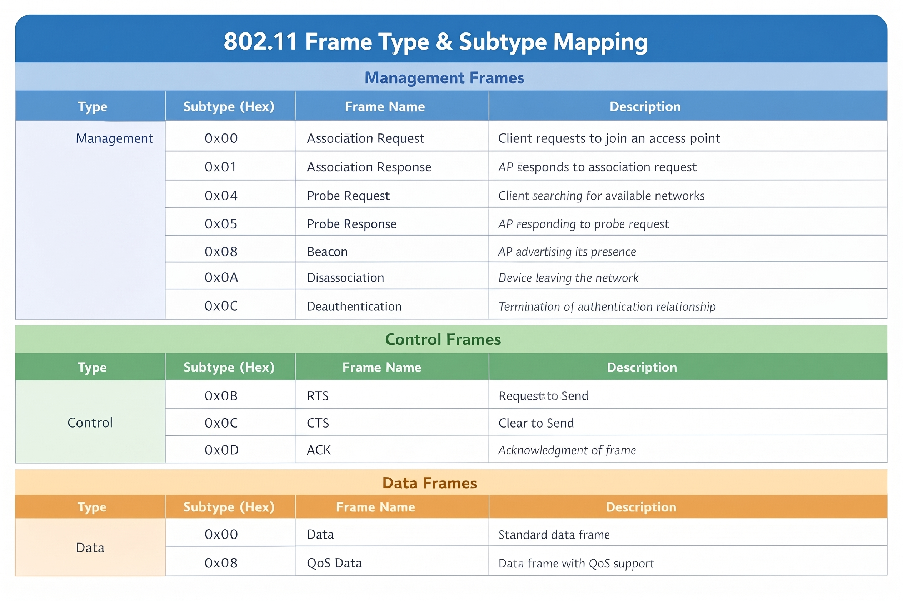
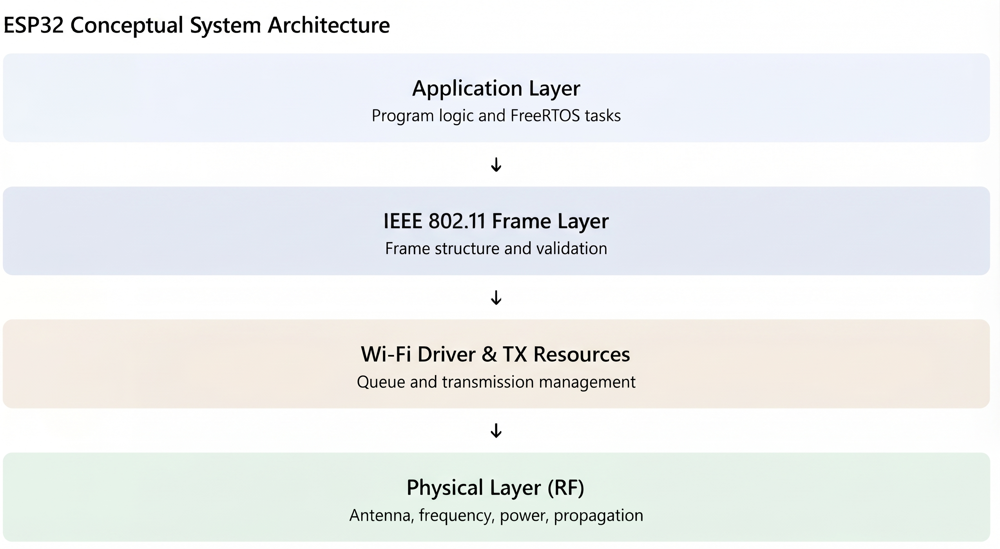
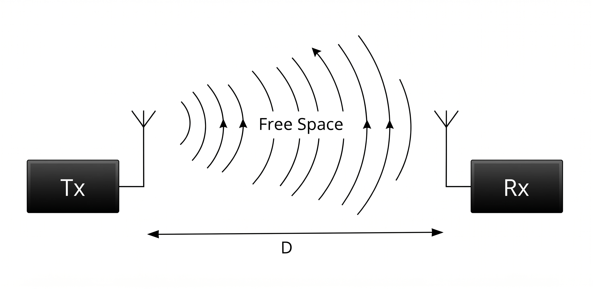
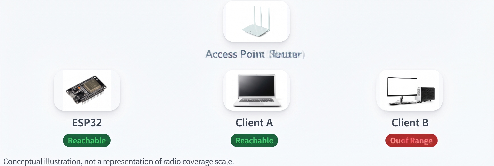
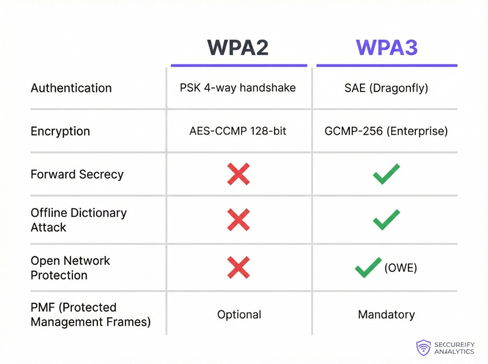

# THEORY

## Operating Layer
The ESP32 can spoof MAC addresses and send forged frames directly to a target by operating entirely at Layer 2 (Data Link Layer). It doesn't even need an IP address or an active network connection. Instead of relying on routing like traditional Layer 3 attacks, this engine skips the TCP/IP stack and injects raw IEEE 802.11 frames straight into the air[cite: 3].

## Management Frames
Wi-Fi devices constantly talk to each other using different types of 802.11 frames. We specifically exploit the Deauthentication frame (subtype 0x0C), which falls under Management Frames. Normally, a device sends this frame to its Access Point (AP) when it wants to disconnect. But since older Wi-Fi standards don't encrypt these frames, the ESP32 can easily pretend to be the AP. It broadcasts a fake deauth frame to a connected client, and the client instantly drops the connection, thinking the router kicked it off[cite: 6].

## System Architecture and Core Isolation
The ESP32 handles the heavy lifting of raw frame injection without crashing by isolating the attack task to Core 1. We use FreeRTOS to pin the application logic away from Core 0, leaving the default Wi-Fi driver and background processes alone. This ensures a stable, uninterrupted flow from the frame generation logic straight down to the physical RF layer[cite: 5].

## Physical Limitations
No matter how fast the code runs, we're still bound by basic radio physics. The ESP32 only pushes about 100mW of transmit power, which is tiny compared to a standard home router. Because radio waves lose energy rapidly over distance—following the Free Space Path Loss principle—fake frames sent from too far away just become background noise. To actually force a disconnect, the ESP32 needs to be physically close enough to the target so its signal overpowers the legitimate AP[cite: 4, 2].

## Security Evolution and WPA3
This trick works flawlessly on older networks, but it hits a brick wall against WPA3. The main reason is PMF (Protected Management Frames). On WPA2 or older setups, PMF is usually disabled, meaning anyone can broadcast unencrypted, unauthenticated management frames. WPA3 changes this by making PMF mandatory. Every management frame gets cryptographically signed. If the ESP32 tries to inject a fake deauth packet into a WPA3 network, the client simply checks the signature, realizes it's forged, and drops it[cite: 1].

